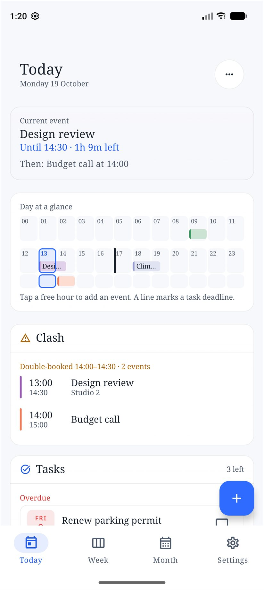
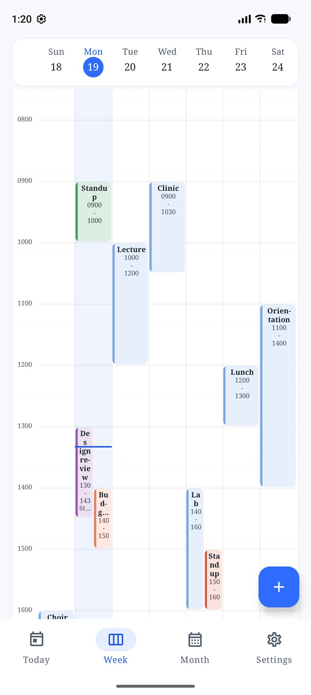
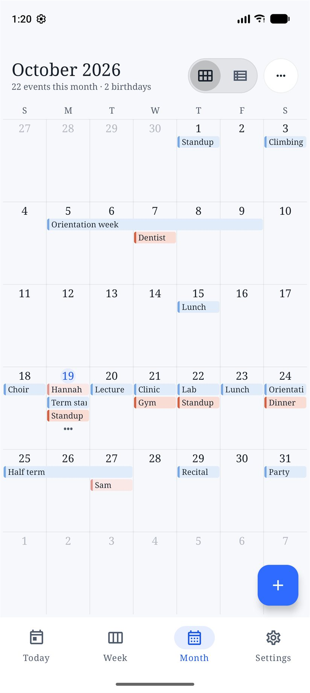
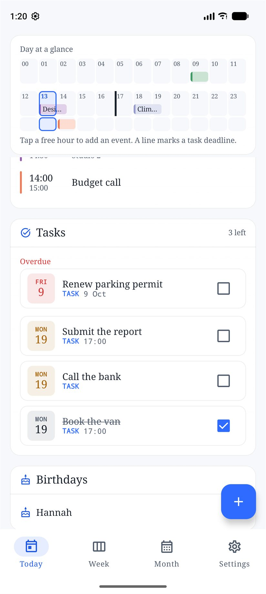

<div align="center">

# Schedule

**A calendar app for the calendars already on your phone.**<br>
Today, week and month views plus home-screen widgets. No account of its own, no internet permission.

[](https://github.com/josephting1105123/Schedule/releases/latest/download/Schedule.apk)


[](LICENSE)

[Website](https://entropicsoftwarelabs.com/schedule/) · [Releases](https://github.com/josephting1105123/Schedule/releases) · [Changelog](CHANGELOG.md)

<br>

&nbsp;
&nbsp;
&nbsp;


</div>

Schedule reads the calendars already synced to your phone (Google and others) and shows them in one place. Edits and new events are written back to those same calendars, so there's nothing to import and nothing to sync.

## Features

- **Today**: an hour grid with clashes, tasks and birthdays
- **Week**: a timetable
- **Month**: a full-page grid or a list
- **Widgets**: one for today, one for the month
- **Write-back**: new events and edits land in the calendar they belong to

## Install

1. Tap **Download APK** above on your phone. It always fetches `Schedule.apk` from the [latest release](https://github.com/josephting1105123/Schedule/releases/latest).
2. Open the file. If Android asks, allow your browser or file manager to install unknown apps.

You need Android 10 or later. To update, install the new APK over the old one.

## Build from source

You need JDK 21 and the Android SDK.

```bash
./gradlew :app:assembleDebug        # app/build/outputs/apk/debug/
./gradlew :app:testDebugUnitTest
```

A release build is signed with the debug key unless `SIGNING_STORE_FILE`, `SIGNING_STORE_PASSWORD`, `SIGNING_KEY_ALIAS` and `SIGNING_KEY_PASSWORD` are all set in the environment.

See [NOTICE.md](NOTICE.md) for the terms that apply to the optional on-device Gemma model.

> [!NOTE]
> This is a public copy of a private repository, so changes are ported in by hand.

## License

MIT. See [LICENSE](LICENSE).
